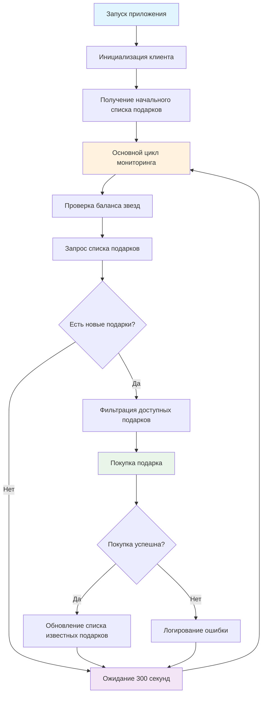
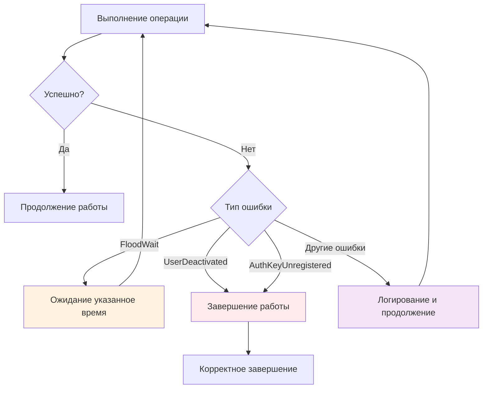

# Telegram Star Gifts Auto-Buyer

## 📋 Описание проекта

Автоматизированный бот для мониторинга и покупки новых подарков в Telegram Premium с использованием звезд. Проект написан на Python с использованием библиотеки Pyrofork для работы с Telegram API.

### 🎯 Основные возможности
- Автоматический мониторинг новых подарков в Telegram
- Проверка баланса звезд аккаунта
- Автоматическая покупка доступных подарков
- Обработка ошибок и ограничений API
- Логирование всех операций в консоль

## 📁 Структура проекта

```
TelegramGifts/
├──TelegramGifts.py              # Основной файл приложения
├── test.session         # Файл сессии Telegram (автогенерируется)
└── README.md           # Документация проекта
```

## 📄 Описание файлов

### main.py
**Назначение:** Основной файл приложения, содержащий всю логику работы бота.

**Ключевые функции:**
- `get_current_star_balance()` - получение текущего баланса звезд
- `purchase_gift(gift_to_purchase)` - покупка конкретного подарка
- `monitor_and_buy_new_gifts()` - основной цикл мониторинга
- `main()` - точка входа в приложение

**Связи с другими файлами:** Нет прямых зависимостей от других файлов проекта.

**Логика работы:**
1. Инициализация клиента Telegram
2. Получение начального списка подарков
3. Бесконечный цикл мониторинга с интервалом 300 секунд
4. Проверка новых подарков и автоматическая покупка

### test.session
**Назначение:** Файл сессии Telegram, создается автоматически при первом запуске.

**Содержимое:** Бинарные данные сессии для аутентификации в Telegram API.

## 🏗️ Архитектура проекта

### Общая структура
Проект построен на основе асинхронного программирования с использованием `asyncio` и библиотеки Pyrofork. Архитектура следует принципу единственной ответственности - каждый модуль отвечает за конкретную функциональность.

### Потоки данных
1. **Инициализация** → Подключение к Telegram API
2. **Мониторинг** → Получение списка подарков
3. **Анализ** → Сравнение с известными подарками
4. **Покупка** → Автоматическая покупка новых подарков
5. **Ожидание** → Пауза до следующего цикла

### Mermaid-схема архитектуры



### Схема обработки ошибок



## 📚 Библиотеки/фреймворки

### Pyrofork
**Назначение:** Асинхронная библиотека для работы с Telegram API
**Где используется:** Основной файл `main.py`
- Создание клиента Telegram
- Вызов API методов для работы с подарками
- Обработка ошибок API

### asyncio
**Назначение:** Стандартная библиотека Python для асинхронного программирования
**Где используется:** Основной файл `main.py`
- Организация асинхронных операций
- Управление циклом мониторинга
- Обработка пауз между запросами

### time
**Назначение:** Стандартная библиотека для работы со временем
**Где используется:** Основной файл `main.py`
- Логирование временных меток

## 🚀 Точка входа и запуск

### Как запускается проект
Проект запускается через выполнение файла `main.py`:

```bash
python main.py
```

### Что выполняется первым
1. **Инициализация клиента** - создание объекта `Client` с указанными API_ID и API_HASH
2. **Запуск клиента** - подключение к Telegram API через `app.start()`
3. **Инициализация мониторинга** - получение начального списка подарков
4. **Запуск основного цикла** - начало бесконечного мониторинга

### Конфигурация перед запуском
```python
API_ID = 1234        # Ваш API ID от Telegram
API_HASH = ""        # Ваш API Hash от Telegram
SESSION_NAME = "test" # Имя файла сессии
CHECK_INTERVAL_SECONDS = 300  # Интервал проверки (5 минут)
```

## 🏛️ Архитектурные особенности

### Нестандартные решения

1. **Использование хэша для оптимизации запросов**
   - Проект использует хэш-механизм Telegram API для получения только изменений в списке подарков
   - Это значительно снижает нагрузку на сервер и ускоряет работу

2. **Глобальные переменные для состояния**
   - `known_gift_ids` - множество известных ID подарков
   - `last_gift_list_hash` - последний полученный хэш списка
   - Это позволяет отслеживать изменения между циклами мониторинга

3. **Двухуровневая обработка ошибок**
   - Обработка специфических ошибок Telegram API (FloodWait, UserDeactivated)
   - Общий обработчик для непредвиденных ошибок

### Причины выбора архитектуры

1. **Асинхронность** - необходима для эффективной работы с Telegram API и обработки множественных операций
2. **Модульность** - разделение логики на отдельные функции для упрощения тестирования и поддержки
3. **Устойчивость к ошибкам** - комплексная обработка ошибок для стабильной работы в долгосрочной перспективе
4. **Оптимизация запросов** - использование хэш-механизма для минимизации нагрузки на API

## 📦 Установка и настройка

### Требования
- Python 3.7+
- pip

### Установка зависимостей
```bash
pip install pyrofork
```

### Настройка API
1. Получите API_ID и API_HASH на [my.telegram.org](https://my.telegram.org)
2. Вставьте их в файл `main.py` в соответствующие переменные
3. Запустите скрипт - при первом запуске потребуется авторизация

### Первый запуск
При первом запуске скрипт запросит:
- Номер телефона
- Код подтверждения из SMS/Telegram
- Пароль двухфакторной аутентификации (если включен)

## 🔧 Использование

### Запуск мониторинга
```bash
python main.py
```

### Остановка
Используйте `Ctrl+C` для корректного завершения работы.

### Логи
Все операции логируются в консоль:
- Текущий баланс звезд
- Обнаружение новых подарков
- Результаты покупок
- Ошибки и предупреждения

## ⚠️ Важные замечания

1. **Ограничения API** - соблюдайте лимиты Telegram API для избежания блокировок
2. **Баланс звезд** - убедитесь в достаточном количестве звезд для покупки подарков
3. **Верификация** - некоторые покупки могут требовать дополнительной верификации
4. **Безопасность** - не передавайте файл сессии третьим лицам

## 🐛 Известные ограничения

- Автоматическая покупка невозможна при необходимости верификации через URL
- Скрипт не обрабатывает случаи с недостаточным балансом звезд для всех подарков
- Интервал проверки фиксирован в коде (300 секунд)

---

Автор: legenda  
Telegram: [@LEGENDA_SD](https://t.me/LEGENDA_SD)
